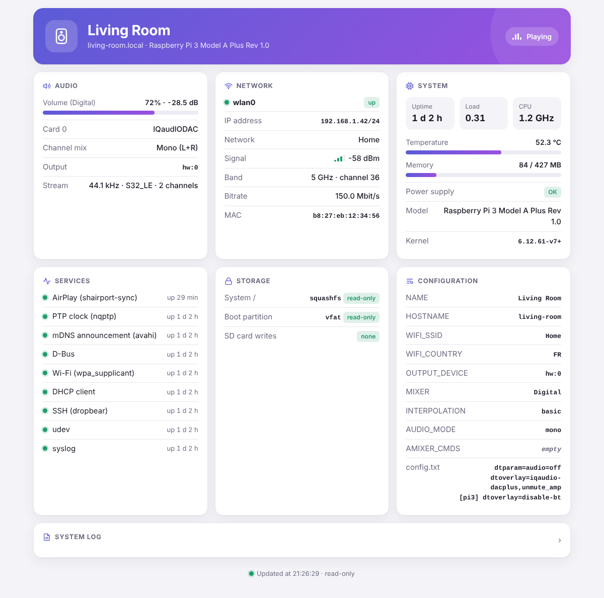

# airplay-os

Minimal Linux distribution (Buildroot) that turns Raspberry Pis into
**AirPlay 2** receivers that can be grouped for multiroom playback from an
iPhone or a Mac.

- **Read-only squashfs root**, `/boot` mounted `ro`: nothing is written to
  the SD card at runtime, and power cuts are harmless.
- **Single** 32-bit ARMv7 image for Raspberry Pi 2 B and Pi 3 A+.
- Per-speaker settings in `airplay.conf` on the boot partition.

Based on **Buildroot 2026.02.3** (LTS), with shairport-sync 4.3.7 (AirPlay 2)
and nqptp 1.2.4 from Buildroot, and the Raspberry Pi 6.12 kernel.

## Layout

```
Dockerfile                  build environment (Debian bookworm, native arm64)
scripts/build.sh            build in Docker + fetch sdcard.img
docs/                       screenshots
br2-airplay/                BR2_EXTERNAL tree
├── configs/airplay_rpi_armv7_defconfig
├── board/airplay/
│   ├── config.txt          firmware: HAT overlay, no arm_64bit
│   ├── cmdline.txt         root=/dev/mmcblk0p2 rootfstype=squashfs ro
│   ├── airplay.conf        per-device configuration template
│   ├── linux.fragment      CONFIG_SQUASHFS=y (a module by default)
│   ├── genimage.cfg        FAT boot (64 MB) + rootfs.squashfs
│   ├── post-build.sh       /etc -> /run symlinks, /var/log on tmpfs
│   ├── post-image.sh       airplay.conf + genimage
│   └── rootfs_overlay/
│       ├── etc/fstab
│       ├── etc/shairport-sync.conf.tpl
│       ├── etc/init.d/S01bootconf S40network
│       └── usr/libexec/airplay/run-nqptp run-shairport respawn-guard
├── package/airplay-web/    Buildroot package of the web interface
└── src/airplay-web/        Rust sources of the web interface
```

## Building the image (macOS + Docker)

Docker Desktop requirements: 8 GB of RAM, all cores, ~40 GB of disk.
On Apple Silicon, the `debian:bookworm` image is pulled as native arm64.

```bash
./scripts/build.sh
```

The script creates the `buildroot-env` image and the `br-work` volume, clones
Buildroot 2026.02.3 into the volume, applies `airplay_rpi_armv7_defconfig`,
builds, and copies `sdcard.img` to the repository root. The first build
(internal toolchain, kernel, ffmpeg) takes several hours. ccache is enabled
(cache stored in the volume).

Other uses:

```bash
./scripts/build.sh shell                  # shell in /work/buildroot
```

```bash
./scripts/build.sh menuconfig             # then: ./scripts/build.sh savedefconfig
```

```bash
./scripts/build.sh shairport-sync-rebuild all
```

After changing the defconfig, reapply it with `./scripts/build.sh defconfig`.
The equivalent manual commands are in section 8 of the specification.

## Building the image on Linux (without Docker)

On an x86_64 or arm64 Linux machine, Buildroot runs directly. Plan for
~40 GB of free disk space and a **non-root** user.

### Dependencies

Debian / Ubuntu:

```bash
sudo apt-get install -y build-essential gcc g++ make patch perl python3 file wget ca-certificates cpio unzip rsync bc git libncurses-dev bzip2 xz-utils gzip diffutils findutils sed bash
```

Fedora:

```bash
sudo dnf install -y gcc gcc-c++ make patch perl python3 file wget which cpio unzip rsync bc git ncurses-devel bzip2 xz gzip diffutils findutils sed bash perl-FindBin perl-IPC-Cmd perl-English perl-Thread-Queue
```

### Build

From the root of this repository, with Buildroot cloned next to it:

```bash
git clone https://gitlab.com/buildroot.org/buildroot.git ../buildroot
```

```bash
git -C ../buildroot checkout 2026.02.3
```

```bash
make -C ../buildroot BR2_EXTERNAL="$PWD/br2-airplay" airplay_rpi_armv7_defconfig
```

```bash
make -C ../buildroot -j"$(nproc)"
```

The image is written to `../buildroot/output/images/sdcard.img`.
`BR2_EXTERNAL` is remembered in `output/`: later `make` calls (for instance
`make -C ../buildroot menuconfig`, then `savedefconfig` to rewrite the
repository's defconfig) no longer need it. The ccache cache lives next to
Buildroot, in `../.buildroot-ccache`, and downloaded sources in
`../buildroot/dl/`.

Notes:
- `PATH` must not contain spaces or relative directories (`.`); Buildroot
  refuses to start otherwise;
- `LD_LIBRARY_PATH` must be empty (`unset LD_LIBRARY_PATH`);
- do not build as root.

When a package's options change in the defconfig (as with `BR2_PACKAGE_XZ`
for kmod or `BR2_PACKAGE_WPA_SUPPLICANT_DEBUG_SYSLOG`), Buildroot does not
rebuild it on its own: run `make <package>-dirclean all`. Likewise, Buildroot
never removes files from `output/target`; only `make clean all` guarantees an
exact rootfs after removing a package or a file.

### Flashing from Linux

Find the SD card with `lsblk` (here `/dev/sdX`, adjust it: **all data on the
device is erased**):

```bash
sudo dd if=../buildroot/output/images/sdcard.img of=/dev/sdX bs=4M conv=fsync status=progress
```

## Flashing and configuring a speaker

1. Flash `sdcard.img` (balenaEtcher, or `dd` to `/dev/rdiskN`).
2. On the **BOOT** partition:
   - `config.txt`: keep **only one** `dtoverlay=` line, matching the HAT
     (`iqaudio-dacplus,unmute_amp` for the DigiAMP+ by default);
   - `airplay.conf`: `NAME`, Wi-Fi (`WIFI_SSID`, `WIFI_PSK`, `WIFI_COUNTRY`),
     `OUTPUT_DEVICE`, `MIXER`, `AUDIO_MODE`;
   - optional: `authorized_keys` (SSH public keys for `root`) and
     `dropbear_ed25519_host_key` (fixed SSH host key, see below).
3. Eject the card cleanly (the only time the boot partition is written).

### Audio HATs

| HAT | Chip | `dtoverlay` | `MIXER` |
|---|---|---|---|
| IQaudio DigiAMP+ | PCM5122 | `iqaudio-dacplus,unmute_amp` | `"Digital"` |
| HiFiBerry DAC+ ADC | PCM5122 | `hifiberry-dacplusadc` | `"Digital"` |
| HiFiBerry DAC+ ADC Pro | PCM5122 | `hifiberry-dacplusadcpro` | `"Digital"` |
| HiFiBerry DAC+ Standard | PCM5122 | `hifiberry-dacplus-std` | `"Digital"` |
| HiFiBerry DAC / DAC+ Light, Pimoroni pHAT DAC | PCM5102A | `hifiberry-dac` | `""` (no hardware volume) |

For HiFiBerry cards and the pHAT DAC, `OUTPUT_DEVICE="hw:CARD=sndrpihifiberry"`
keeps working even if another sound card shows up; check the name with
`aplay -l`. With `MIXER=""`, shairport-sync adjusts the volume in software.

### Single-speaker players

`AUDIO_MODE` in `airplay.conf` selects the channel mix, applied by
shairport-sync (`playback_mode`) before the hardware volume:

| `AUDIO_MODE` | Left output | Right output | Use |
|---|---|---|---|
| `stereo` (default) | L | R | two speakers |
| `mono` | (L+R)/2 | (L+R)/2 | single driver, wired to either side |
| `left` | L | L | play the left channel only |
| `right` | R | R | play the right channel only |
| `reverse` | R | L | speakers wired the wrong way round |

An unknown value falls back to `stereo` (shairport-sync would refuse to
start otherwise).

The hostname is derived from `NAME` (`Living Room` → `living-room.local`);
set `HOSTNAME=` explicitly if the name contains accented characters.

## `airplay.conf` reference

`airplay.conf` sits at the root of the boot partition. `S01bootconf` reads it
at every boot: changes take effect on the next reboot.

**Syntax.** The file uses shell syntax: one `KEY="value"` per line, with no
spaces around `=`. Lines starting with `#` are comments. Windows/Mac line
endings (CRLF) are handled. Because the file is evaluated as a shell script,
use single quotes for values containing `$`, `` ` `` or `\`
(`NAME='Bob$ room'`), and escape double quotes inside double quotes
(`NAME="The \"Den\""`). If the file has a syntax error, it is ignored as a
whole and every setting falls back to its default (the message appears on the
HDMI console). A missing key also takes its default.

### Identity

| Key | Default | Description |
|---|---|---|
| `NAME` | `AirPlay` | Speaker name shown in AirPlay on the iPhone or Mac. Any text, accents and spaces included. |
| `HOSTNAME` | derived from `NAME` | Network name: `http://<HOSTNAME>.local`, `ssh root@<HOSTNAME>.local`, and the name sent to the DHCP server. |

`HOSTNAME` is always normalized: lowercased, every character other than
`a-z`, `0-9` and `-` becomes `-`, repeated dashes are merged, leading and
trailing dashes are removed, and the result is cut to 63 characters. If
nothing is left, `airplay` is used. Examples: `Living Room` → `living-room`,
`Séjour` → `s-jour` (hence setting `HOSTNAME` explicitly when the name has
accented characters). Give each speaker a distinct hostname.

### Wi-Fi

| Key | Default | Description |
|---|---|---|
| `WIFI_SSID` | empty | Network name. Empty: Wi-Fi is not started (Ethernet only). Any character is allowed, and hidden networks work. |
| `WIFI_PSK` | empty | Wi-Fi password: a passphrase of 8 to 63 characters, or the raw 64-hex-digit key. Empty: open network (no password). |
| `WIFI_COUNTRY` | `FR` | Two-letter ISO 3166 country code (`FR`, `DE`, `GB`, `US`...). Sets the allowed channels and transmit power; a wrong or missing country can hide 5 GHz networks. |

- WPA2-Personal (and WPA2/WPA3 transition mode) networks are supported;
  WPA3-only (SAE) and enterprise (802.1X) networks are not.
- An invalid `WIFI_PSK` (too short or too long) leaves Wi-Fi off and logs
  `invalid WIFI_PSK` on the console.
- The password is turned into a hashed key in `/run/wpa_supplicant.conf`
  (readable by root only) and is never shown by the web interface. It is
  still stored in clear text in `airplay.conf`, on a FAT partition anyone
  holding the SD card can read.
- Ethernet needs no setting: if a cable is plugged in, `eth0` gets an address
  by DHCP, alongside Wi-Fi if both are present.

### Audio

| Key | Default | Description |
|---|---|---|
| `OUTPUT_DEVICE` | `hw:0` | ALSA output device. `hw:0` is the first sound card; `hw:CARD=<id>` targets a card by name (the id is the word before the brackets in `aplay -l`). Prefer `hw:` over `plughw:`: shairport-sync then drives the card directly, which keeps multiroom sync accurate. |
| `MIXER` | `Digital` | ALSA mixer control used for the volume (list them with `amixer scontrols`). The iPhone volume then drives the hardware volume. Empty (`MIXER=""`): software volume, required for cards with no volume control such as PCM5102A boards. |
| `AUDIO_MODE` | `stereo` | Channel mix: `stereo`, `mono`, `left`, `right` or `reverse` (see [Single-speaker players](#single-speaker-players)). Case-insensitive; an unknown value falls back to `stereo`. |
| `INTERPOLATION` | `basic` | How shairport-sync stays in sync by adding or dropping audio frames: `basic` (lightest, recommended on the Pi 2 B) or `auto`. Any other value falls back to `basic`. `soxr` is not available: shairport-sync is built without it. |
| `AMIXER_CMDS` | empty | Extra `amixer` commands, separated by `;`, applied each time shairport-sync starts (ALSA settings are not persistent on a read-only system). Each command is the list of `amixer` arguments, quotes allowed. |

See [Audio HATs](#audio-hats) for the `MIXER` value of each HAT. Examples of
`AMIXER_CMDS`:

```
# DigiAMP+ or HiFiBerry DAC+: analog gain at 0 dB, boost off
AMIXER_CMDS="-c 0 sset Analogue 0dB;-c 0 sset 'Analogue Playback Boost' 0dB"
```

A failing command is logged (`amixer ...: failed`) and does not prevent
shairport-sync from starting.

### Example

```
NAME="Kitchen"
HOSTNAME="kitchen"

WIFI_SSID="Home"
WIFI_PSK="correct horse battery staple"
WIFI_COUNTRY="FR"

OUTPUT_DEVICE="hw:CARD=sndrpihifiberry"
MIXER="Digital"
AUDIO_MODE="mono"
INTERPOLATION="basic"
AMIXER_CMDS=""
```

The values actually applied can be checked in `/run/airplay.env` or in the
Configuration card of the web interface.

## Diagnostics

```bash
ssh root@living-room.local
```

- Key-based login only (`/boot/authorized_keys`, one key per line). The HDMI
  console on `tty1` accepts `root` without a password.
- SSH host keys are regenerated at every boot. For a fixed fingerprint, fetch
  the key generated after the first boot and first connection:

  ```bash
  ssh root@living-room.local cat /run/dropbear/dropbear_ed25519_host_key > dropbear_ed25519_host_key
  ```

  then copy that file to the root of the speaker's boot partition (one key
  per speaker, never shared).
- Logs: `/var/log/messages` (tmpfs, lost on reboot).
- Generated configs: `/run/airplay.env`, `/run/shairport-sync.conf`,
  `/run/wpa_supplicant.conf`.
- Restart shairport-sync (after editing `/run/shairport-sync.conf` for a
  test, for example): `killall shairport-sync`; init restarts it.

## Web interface (read-only)

Each speaker shows its status at **`http://<hostname>.local`** (for example
`http://living-room.local`). The service is announced over mDNS
(`_http._tcp`) and the page refreshes every 3 s. It has light and dark
themes and adapts to phones.



- **Audio**: hardware mixer volume, sound card, channel mix (`AUDIO_MODE`),
  current stream (rate, format), "Playing" indicator.
- **Network**: IP, and for Wi-Fi the SSID, signal, band and channel, and
  bitrate.
- **System**: uptime, load, CPU frequency, temperature, memory,
  **undervoltage** alarm (`raspberrypi-hwmon` driver).
- **Services**: expected processes and how long they have been running (a
  recent restart is visible at a glance).
- **Storage**: `/` and `/boot` read-only, number of writes to the SD card
  since boot (validation criterion from section 10).
- **Configuration**: values from `/run/airplay.env` and active `config.txt`
  lines.
- **Log**: tail of `/var/log/messages`.

Nothing is ever written (only `GET`/`HEAD` requests are accepted) and the
Wi-Fi password is not exposed. There is no authentication: the page is
visible to the whole local network.

The server (`src/airplay-web`) is written in Rust **with no external
dependencies**: the package builds offline with Buildroot's prebuilt Rust,
and the binary is about 500 KB. HTML, CSS and JS are embedded in the binary,
with no external font or asset. It is started and supervised by init like
nqptp and shairport-sync. To remove it from the image:
`# BR2_PACKAGE_AIRPLAY_WEB is not set`.

Development on a Linux machine, without a Pi:

```bash
cd br2-airplay/src/airplay-web && cargo test
```

```bash
AIRPLAY_WEB_LISTEN=127.0.0.1:8080 cargo run
```

`AIRPLAY_WEB_ROOT=/path/to/a/fake/tree` reads `/proc`, `/sys`, `/run` and
`/boot` from another directory, to simulate a speaker.

## Boot sequence

| Script | Role |
|---|---|
| `S01bootconf` | reads `/boot/airplay.conf`, sets the hostname, generates the configs in `/run`, copies the SSH keys |
| `S10udevd` | eudev: loads the HAT and Wi-Fi modules |
| `S30dbus` | |
| `S40network` | eth0 via DHCP; wlan0 via wpa_supplicant + DHCP, `power_save off` |
| `S50avahi-daemon` | mDNS announcement |
| `S50dropbear` | SSH |

Once `rcS` is done, BusyBox init starts the supervised services declared in
`/etc/inittab` (`respawn` action, added by `post-build.sh`) and restarts them
if they exit:

| Service | Script | Role |
|---|---|---|
| nqptp | `run-nqptp` | PTP clock (UDP 319/320, root) |
| shairport-sync | `run-shairport` | waits for the sound card, applies `AMIXER_CMDS`, runs shairport-sync in the foreground |
| airplay-web | `run-airplay-web` | read-only web interface, port 80 |

To avoid spinning on a service that crashes at startup, `respawn-guard` waits
before each restart: 2 s, then 4, 8... up to 60 s. The delay goes back to 2 s
once the service has stayed up for more than 5 minutes. Restarts are logged
in `/var/log/messages`.

## Deviations from and clarifications of the specification

- **`amixer` settings**: applied by `run-shairport` rather than
  `S01bootconf`, since the sound card only exists once udev (S10) has loaded
  the modules.
- **Network**: a dedicated `S40network` script replaces ifupdown (a single
  image must handle Ethernet only, Wi-Fi only, or both).
- **fstab**: besides the planned lines, `proc`, `sysfs`, `devpts` and
  `/dev/shm` (shared memory required between nqptp and shairport-sync).
  `/var/log`, a symlink to `/tmp` in the Buildroot skeleton, becomes a real
  directory so its tmpfs can be mounted.
- **Supervision**: nqptp and shairport-sync are not started by
  `S49nqptp`/`S50shairport` scripts but by init (`inittab`, `respawn`), which
  restarts them if they exit. The `S90nqptp` and `S99shairport-sync` scripts
  installed by Buildroot are removed in post-build.
- **Web interface**: section 2 excluded it. This one is read-only and can be
  dropped from the image with one defconfig line.
- **Bluetooth** disabled on the Pi 3 (`dtoverlay=disable-bt`): it shares the
  CYW43455 antenna.
- `config.txt` and `cmdline.txt` are installed by the `rpi-firmware` package
  (`BR2_PACKAGE_RPI_FIRMWARE_{CONFIG,CMDLINE}_FILE`); `post-image.sh` adds
  `airplay.conf` and runs genimage. The kernel is copied as `kernel7.img`.

## Verified points (Buildroot 2026.02.3)

- AirPlay 2 option: `BR2_PACKAGE_SHAIRPORT_SYNC_AIRPLAY2` (selects `nqptp`,
  ffmpeg, libplist, libsodium, libgcrypt). No external package needed.
- Wi-Fi firmware: `BR2_PACKAGE_BRCMFMAC_SDIO_FIRMWARE_RPI_WIFI`.
- DTB: there is no `bcm2710-rpi-3-a-plus.dtb`; the 3 A+ firmware loads
  `bcm2710-rpi-3-b-plus.dtb`, which is included.
- `iqaudio-dacplus`, `hifiberry-dacplusadc`, `hifiberry-dacplusadcpro`,
  `hifiberry-dacplus-std` and `hifiberry-dac` overlays are present.
- `bcm2709_defconfig` has `CONFIG_SQUASHFS=m`: `linux.fragment` turns it into
  `y`, otherwise the root cannot be mounted.
- `bcm2709_defconfig` compresses modules with xz: `BR2_PACKAGE_XZ=y` is
  required for kmod to load them.

Still to check on hardware: ALSA card and mixer names (`aplay -l`,
`amixer scontrols`) for each HAT.

## Implementation plan

Steps 1 to 6 of the plan (section 9 of the specification) are combined in
the defconfig; validation (section 10) happens on hardware.

- [ ] `mount`: `/` as `squashfs (ro)`, `/boot` as `vfat (ro)`
- [ ] No writes to `mmcblk0` (`cat /proc/diskstats`)
- [ ] 10 power cuts during playback, 10 clean reboots
- [ ] Same image on Pi 2 B and Pi 3 A+
- [ ] Sound and hardware volume on DigiAMP+ and DAC+ ADC
- [ ] Speakers visible and selectable together on iOS
- [ ] Correct sync between two speakers in the same room
- [ ] Stable Wi-Fi on the 3 A+ during long listening sessions
